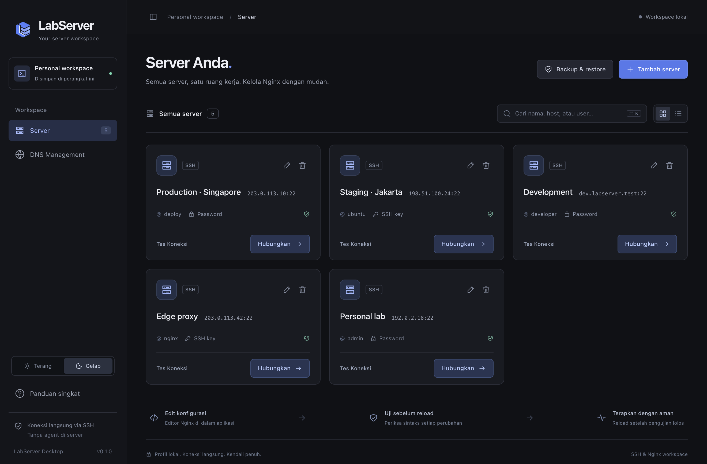
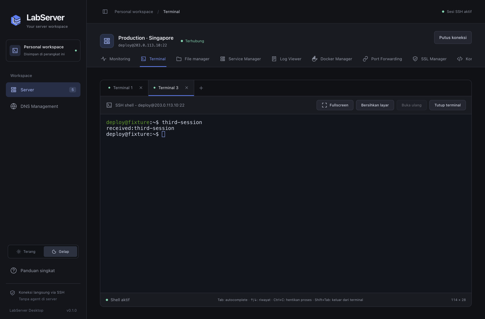
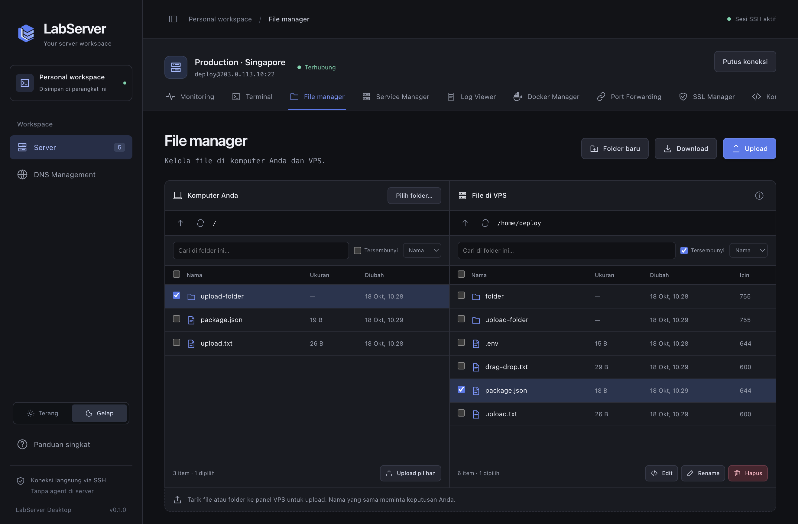
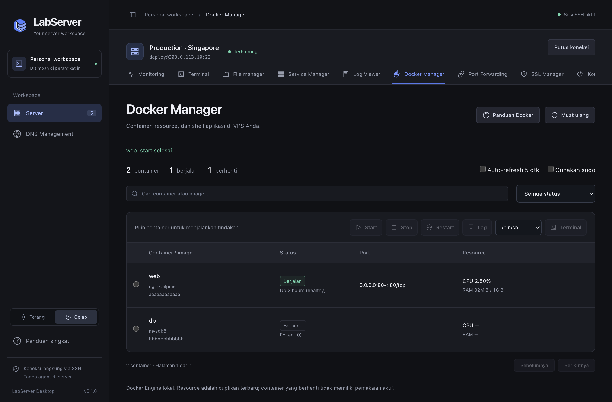
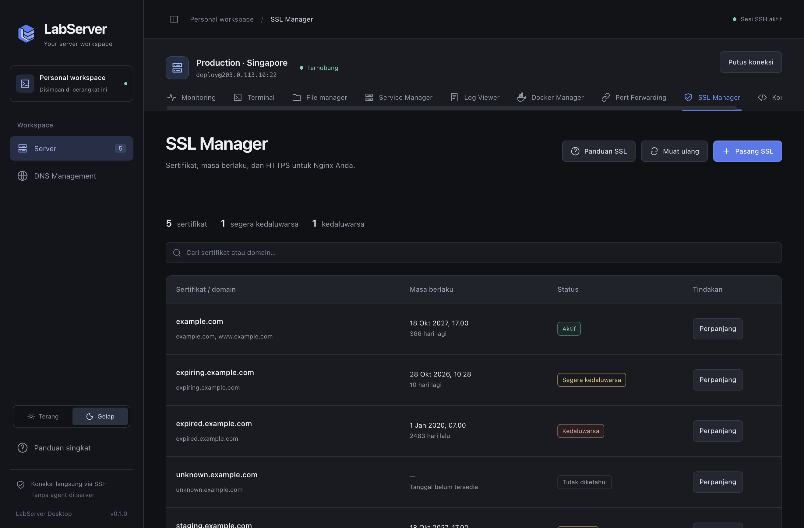

# LabServer

Kelola server Linux dari satu aplikasi desktop, lewat SSH. Tanpa agent, tidak ada yang dipasang di server.



## Unduh (macOS)

| Mac | Unduh |
|---|---|
| **Apple Silicon** (M1, M2, M3, M4) | [LabServer-macOS-arm64.dmg](https://github.com/rendra24/LabServer/releases/latest/download/LabServer-macOS-arm64.dmg) |
| Intel | [LabServer-macOS-x64.dmg](https://github.com/rendra24/LabServer/releases/latest/download/LabServer-macOS-x64.dmg) |

Semua versi ada di [Releases](https://github.com/rendra24/LabServer/releases). Windows belum tersedia.

**Pertama kali membuka:** aplikasi belum ditandatangani Apple, jadi macOS akan memblokirnya. Seret ke *Applications*, klik kanan → **Open** → **Open**. Jika masih diblokir:

```bash
xattr -dr com.apple.quarantine "/Applications/LabServer.app"
```

## Fitur

| | |
|---|---|
| **Monitoring** | CPU, memori, disk, jaringan, dan metrik Nginx dari Prometheus lewat SSH tunnel |
| **Terminal** | Hingga 8 tab shell per server, warna ANSI, fullscreen |
| **File manager** | Dua panel lokal ↔ server (SFTP), upload/download, editor bawaan |
| **Nginx** | Edit, tambah, clone, aktif/nonaktif vhost; `nginx -t` sebelum reload |
| **Service & Log** | Start/stop/restart layanan systemd, lihat jurnal dan log Nginx |
| **Docker** | Daftar container, log, resource, terminal container |
| **SSL** | Pasang dan perpanjang sertifikat Let's Encrypt (Certbot) |
| **Port Forwarding** | Tunnel lokal ke database/layanan di server |
| **DNS** | Kelola record Cloudflare |
| **Backup** | Backup terenkripsi profil server dan kredensial |

Login dengan SSH key atau password. Tema terang dan gelap.

| Terminal | File manager |
|---|---|
|  |  |
| **Docker** | **SSL** |
|  |  |

## Keamanan

- Fingerprint host diminta persetujuan saat pertama kali; jika berubah, koneksi diblokir.
- Password hanya disimpan jika dipilih, terenkripsi Keychain macOS.
- Renderer disandbox tanpa akses Node; tidak ada CDN.
- Reload Nginx selalu menjalankan `nginx -t` dulu.

## Pengembangan

```bash
npm install
npm start       # jalankan aplikasi
npm test        # tes
npm run lint
```

Panduan lengkap tiap fitur, kebutuhan di server, dan cara build: [docs/GUIDE.md](docs/GUIDE.md). Cara merilis: [RELEASING.md](RELEASING.md). Dokumen lain: [docs/](docs/README.md).
