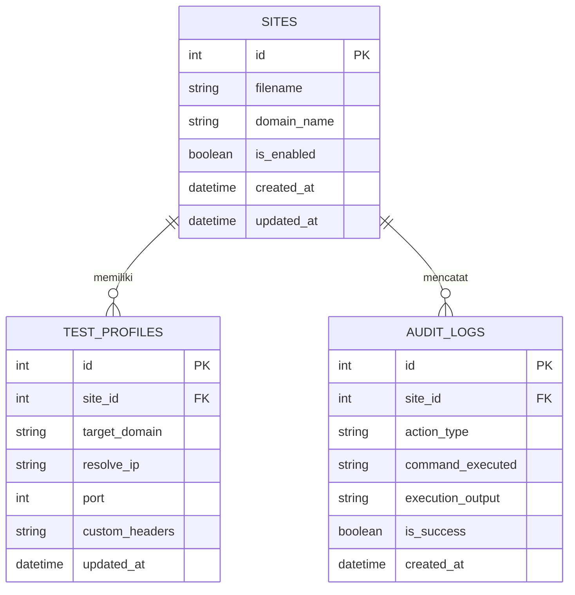

# DATABASE.md — Dashboard Server

Dokumen ini mendefinisikan skema basis data PostgreSQL, relasi, constraint, indeks, alur migrasi, data awal (*seed*), serta kebijakan backup dan retensi untuk aplikasi Dashboard Server.

---

## Entity Relationship Diagram (ERD)



---

## Spesifikasi Tabel

### 1. Tabel `sites`
Menyimpan metadata berkas konfigurasi *virtual host* Nginx yang berada di direktori `/etc/nginx/sites-available/` dan status aktivasinya di `/etc/nginx/sites-enabled/`.

| Kolom | Tipe Data | Nullable | Default | Keterangan |
| :--- | :--- | :--- | :--- | :--- |
| `id` | `INTEGER` (SERIAL) | `NOT NULL` | *auto-increment* | Primary Key |
| `filename` | `VARCHAR(255)` | `NOT NULL` | - | Nama berkas konfigurasi di disk server |
| `domain_name` | `VARCHAR(255)` | `NOT NULL` | - | Domain utama (nilai direktif `server_name`) |
| `is_enabled` | `BOOLEAN` | `NOT NULL` | `false` | Status symlink di `sites-enabled` |
| `created_at` | `TIMESTAMPTZ` | `NOT NULL` | `CURRENT_TIMESTAMP` | Waktu pencatatan rekaman |
| `updated_at` | `TIMESTAMPTZ` | `NOT NULL` | `CURRENT_TIMESTAMP` | Waktu pembaruan rekaman terakhir |

* **Constraints**:
  * `pk_sites`: Primary Key (`id`)
  * `uq_sites_filename`: Unique (`filename`)
* **Indexes**:
  * `idx_sites_filename`: B-tree pada kolom `filename` (pencarian berkas cepat)
  * `idx_sites_is_enabled`: B-tree pada kolom `is_enabled` (penyaringan status aktif)
* **Relasi**:
  * `1:N` ke `test_profiles` (`ON DELETE CASCADE`)
  * `1:N` ke `audit_logs` (`ON DELETE SET NULL`)

---

### 2. Tabel `test_profiles`
Menyimpan parameter konfigurasi pengujian jaringan `curl` (resolusi IP kustom, port, dan HTTP headers) per situs.

| Kolom | Tipe Data | Nullable | Default | Keterangan |
| :--- | :--- | :--- | :--- | :--- |
| `id` | `INTEGER` (SERIAL) | `NOT NULL` | *auto-increment* | Primary Key |
| `site_id` | `INTEGER` | `NOT NULL` | - | Foreign Key ke `sites.id` |
| `target_domain` | `VARCHAR(255)` | `NOT NULL` | - | Domain target pengujian curl |
| `resolve_ip` | `VARCHAR(45)` | `NOT NULL` | - | IP tujuan parameter `--resolve` (IPv4/IPv6) |
| `port` | `INTEGER` | `NOT NULL` | `80` | Port tujuan koneksi |
| `custom_headers`| `TEXT` | `NULL` | `NULL` | Header kustom format JSON string |
| `updated_at` | `TIMESTAMPTZ` | `NOT NULL` | `CURRENT_TIMESTAMP` | Waktu pembaruan konfigurasi profil |

* **Constraints**:
  * `pk_test_profiles`: Primary Key (`id`)
  * `fk_test_profiles_site_id`: Foreign Key (`site_id`) REFERENCES `sites` (`id`) ON DELETE CASCADE
  * `chk_test_profiles_port`: Check constraint (`port > 0 AND port <= 65535`)
* **Indexes**:
  * `idx_test_profiles_site_id`: B-tree pada kolom `site_id`
* **Relasi**:
  * `N:1` ke `sites`

---

### 3. Tabel `audit_logs`
Menyimpan riwayat operasional eksekusi sistem (modifikasi file, `nginx -t`, `systemctl reload`, dan pengetesan `curl`).

| Kolom | Tipe Data | Nullable | Default | Keterangan |
| :--- | :--- | :--- | :--- | :--- |
| `id` | `INTEGER` (SERIAL) | `NOT NULL` | *auto-increment* | Primary Key |
| `site_id` | `INTEGER` | `NULL` | `NULL` | Foreign Key ke `sites.id` |
| `action_type` | `VARCHAR(50)` | `NOT NULL` | - | Jenis aksi: `NGINX_TEST`, `NGINX_RELOAD`, `CONFIG_SAVE`, `CURL_TEST` |
| `command_executed`| `TEXT` | `NOT NULL` | - | Perintah CLI mentah yang dieksekusi |
| `execution_output`| `TEXT` | `NULL` | `NULL` | Keluaran `stdout` / `stderr` terminal |
| `is_success` | `BOOLEAN` | `NOT NULL` | - | Status keberhasilan eksekusi (exit code 0) |
| `created_at` | `TIMESTAMPTZ` | `NOT NULL` | `CURRENT_TIMESTAMP` | Waktu eksekusi aksi |

* **Constraints**:
  * `pk_audit_logs`: Primary Key (`id`)
  * `fk_audit_logs_site_id`: Foreign Key (`site_id`) REFERENCES `sites` (`id`) ON DELETE SET NULL
* **Indexes**:
  * `idx_audit_logs_site_id`: B-tree pada kolom `site_id`
  * `idx_audit_logs_created_at`: B-tree pada kolom `created_at DESC` (pengurutan log terbaru)
  * `idx_audit_logs_action_type`: B-tree pada kolom `action_type`
* **Relasi**:
  * `N:1` ke `sites`

---

## DDL Skema Basis Data

Eksekusi skema mentah berbasis PostgreSQL:

```sql
-- DDL Dashboard Server

CREATE TABLE sites (
    id SERIAL CONSTRAINT pk_sites PRIMARY KEY,
    filename VARCHAR(255) NOT NULL CONSTRAINT uq_sites_filename UNIQUE,
    domain_name VARCHAR(255) NOT NULL,
    is_enabled BOOLEAN NOT NULL DEFAULT FALSE,
    created_at TIMESTAMPTZ NOT NULL DEFAULT CURRENT_TIMESTAMP,
    updated_at TIMESTAMPTZ NOT NULL DEFAULT CURRENT_TIMESTAMP
);

CREATE INDEX idx_sites_filename ON sites(filename);
CREATE INDEX idx_sites_is_enabled ON sites(is_enabled);

CREATE TABLE test_profiles (
    id SERIAL CONSTRAINT pk_test_profiles PRIMARY KEY,
    site_id INTEGER NOT NULL CONSTRAINT fk_test_profiles_site_id REFERENCES sites(id) ON DELETE CASCADE,
    target_domain VARCHAR(255) NOT NULL,
    resolve_ip VARCHAR(45) NOT NULL,
    port INTEGER NOT NULL DEFAULT 80 CONSTRAINT chk_test_profiles_port CHECK (port > 0 AND port <= 65535),
    custom_headers TEXT NULL,
    updated_at TIMESTAMPTZ NOT NULL DEFAULT CURRENT_TIMESTAMP
);

CREATE INDEX idx_test_profiles_site_id ON test_profiles(site_id);

CREATE TABLE audit_logs (
    id SERIAL CONSTRAINT pk_audit_logs PRIMARY KEY,
    site_id INTEGER NULL CONSTRAINT fk_audit_logs_site_id REFERENCES sites(id) ON DELETE SET NULL,
    action_type VARCHAR(50) NOT NULL,
    command_executed TEXT NOT NULL,
    execution_output TEXT NULL,
    is_success BOOLEAN NOT NULL,
    created_at TIMESTAMPTZ NOT NULL DEFAULT CURRENT_TIMESTAMP
);

CREATE INDEX idx_audit_logs_site_id ON audit_logs(site_id);
CREATE INDEX idx_audit_logs_created_at ON audit_logs(created_at DESC);
CREATE INDEX idx_audit_logs_action_type ON audit_logs(action_type);
```

---

## Strategi Migrasi

Untuk menjaga konsistensi skema antar lingkungan lokal dan VPS:

1. **Alat Pengelola Migrasi**: Menggunakan `Alembic` bawaan ekosistem Python.
2. **Penyimpanan Skrip**: Direktori `migrations/versions/` di root proyek backend.
3. **Konvensi Versi**: `YYYYMMDDHHMM_<deskripsi_singkat>.py` (timestamp-based linear migration).
4. **Prosedur Eksekusi**:
   - Menjalankan migrasi: `alembic upgrade head`
   - Membatalkan migrasi: `alembic downgrade -1`
5. **Aturan Migrasi**:
   - Dilarang mengubah file migrasi yang sudah masuk branch `main` atau VPS. Setiap perubahan skema baru wajib membuat revisi migrasi baru.
   - Kolom baru wajib memiliki nilai default jika didefinisikan sebagai `NOT NULL`.

---

## Data Seed

Gunakan skrip SQL berikut untuk inisialisasi data awal lingkungan pengujian sesuai PRD:

```sql
-- Inisialisasi Data Situs Contoh
INSERT INTO sites (filename, domain_name, is_enabled, created_at, updated_at)
VALUES 
('default', 'localhost', true, NOW(), NOW()),
('app-php83.local', 'app-php83.local', true, NOW(), NOW()),
('legacy-php74.local', 'legacy-php74.local', false, NOW(), NOW());

-- Inisialisasi Profil Pengujian Curl
INSERT INTO test_profiles (site_id, target_domain, resolve_ip, port, custom_headers, updated_at)
VALUES 
(2, 'app-php83.local', '127.0.0.1', 80, '{"Host": "app-php83.local"}', NOW()),
(3, 'legacy-php74.local', '127.0.0.1', 80, '{"Host": "legacy-php74.local"}', NOW());

-- Inisialisasi Log Awal
INSERT INTO audit_logs (site_id, action_type, command_executed, execution_output, is_success, created_at)
VALUES 
(2, 'NGINX_TEST', 'nginx -t', 'nginx: the configuration file /etc/nginx/nginx.conf syntax is ok\nnginx: configuration file /etc/nginx/nginx.conf test is successful', true, NOW());
```

---

## Strategi Backup dan Retensi Data

### 1. Prosedur Backup Rutin
Gunakan utilitas bawaan PostgreSQL `pg_dump` dengan kompresi gzip. Dijalankan via Linux `cron` pada user sistem:

```bash
# Backup otomatis setiap pukul 02:00 WIB
0 2 * * * pg_dump -U postgres -d dashboard_server -F c -b -v -f "/var/backups/db/dashboard_server_$(date +\%Y\%m\%d_\%H\%M\%S).dump"
```

* **Target Direktori**: `/var/backups/db/`
* **Format**: Custom binary format (`-F c`), mendukung *selective restore* dan kompresi native.

### 2. Prosedur Restore
```bash
pg_restore -U postgres -d dashboard_server -v /var/backups/db/dashboard_server_YYYYMMDD_HHMMSS.dump
```

### 3. Kebijakan Retensi
* **Retensi Berkas Backup**: Disimpan selama 7 hari kalender di server lokal. Berkas di atas 7 hari dihapus otomatis melalui script pembersihan:
  ```bash
  find /var/backups/db/ -type f -name "*.dump" -mtime +7 -delete
  ```
* **Retensi Tabel `audit_logs`**: Rekaman log dipertahankan selama 90 hari. Log yang lebih lama dari 90 hari dapat dibersihkan secara berkala menggunakan query native:
  ```sql
  DELETE FROM audit_logs WHERE created_at < NOW() - INTERVAL '90 days';
  ```

---

## Asumsi

1. **Mesin Database**: PostgreSQL versi 12 atau yang lebih tinggi (mendukung standard ISO `TIMESTAMPTZ` dan optimasi constraint check).
2. **Karakter Filename**: Kolom `filename` pada tabel `sites` merepresentasikan nama file tunggal tanpa path (misal: `default`, bukan `/etc/nginx/sites-available/default`).
3. **Penyimpanan Format Header**: Kolom `custom_headers` disimpan dalam bentuk teks string JSON yang valid (misalnya `{"Host": "example.local"}`) dan diparsing di layer aplikasi sebelum disuntikkan ke parameter CLI `curl`.
4. **Log Orphan**: Apabila data situs pada tabel `sites` dihapus, histori aktivitas terkait pada `audit_logs` tetap dipertahankan dengan kolom `site_id` menjadi `NULL` demi kebutuhan pelacakan riwayat sistem.