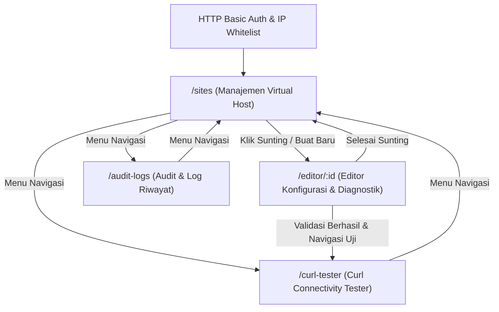

# FRONTEND — Dashboard Server

Dokumen ini mendefinisikan spesifikasi antarmuka pengguna, komponen, interaksi status, dan standar implementasi frontend untuk Dashboard Server.

---

## 1. Arsitektur Frontend & Tech Stack

Antarmuka Dashboard Server dibangun menggunakan prinsip arsitektur yang ringkas, mengandalkan standar web native untuk performa maksimal dan latensi minimal saat berinteraksi dengan server lokal/VPS.

| Komponen | Pilihan Teknologi | Implementasi |
| :--- | :--- | :--- |
| **Markup & Layout** | HTML5 Semantik | Struktur berbasis tag native (`main`, `nav`, `section`, `article`) |
| **Styling Engine** | Tailwind CSS | Utility classes, dark mode native untuk tampilan konsol terminal |
| **Code Editor** | Monaco Editor / Ace Editor | Embed client-side editor dengan mode sintaks Nginx |
| **Data Fetching** | Fetch API (Native ES6+) | Async/await untuk komunikasi JSON REST API ke backend Python |
| **State Handling** | Native DOM & Event Handling | Manajemen state lokal terdistribusi per view tanpa overhead bundler |

---

## 2. Alur Navigasi



---

## 3. Daftar Halaman dan Rute

| Rute | Halaman | Deskripsi Fungsional |
| :--- | :--- | :--- |
| `/sites` | Manajemen Virtual Host | Daftar berkas konfigurasi Nginx, status aktivasi symlink, dan tombol aksi. |
| `/editor/:id` | Editor Konfigurasi & Diagnostik | Editor teks raw Monaco/Ace, aksi simpan, validasi `nginx -t`, dan reload daemon. |
| `/editor/new` | Berkas Konfigurasi Baru | Editor kosong untuk membuat berkas vhost baru pada `/etc/nginx/sites-available/`. |
| `/curl-tester` | Curl Connectivity Tester | Pengujian HTTP/HTTPS custom `--resolve`, latency TTFB, dan inspeksi header respon. |
| `/audit-logs` | Audit & Log Riwayat | Tabel catatan riwayat aksi sistem, hasil eksekusi perintah, dan perubahan konfigurasi. |

---

## 4. Komponen Utama per Halaman

### Global Layout
- **Global Navigation Bar**: 
  - Logo/Identitas Dashboard Server.
  - Menu link: *Sites*, *Curl Tester*, *Audit Logs*.
  - Indikator status koneksi API backend.

---

### Halaman `/sites` (Manajemen Virtual Host)
- **Header Actions**: Tombol "Buat Konfigurasi Baru" (mengarahkan ke `/editor/new`) dan tombol cepat "Test All Nginx Syntax".
- **Sites Table**:
  - Kolom *Filename* (`sites-available`).
  - Kolom *Primary Domain* (`domain_name`).
  - Kolom *Status Symlink* (Badge visual Aktif / Nonaktif).
  - Kolom *Toggle Action* (`is_enabled` switcher untuk symlink ke `sites-enabled`).
  - Kolom *Updated At* (Timestamp pembaruan).
  - Kolom *Action Buttons* (Edit, Hapus).
- **Confirmation Modal**: Dialog validasi sebelum menghapus berkas konfigurasi dari disk.

---

### Halaman `/editor/:id` dan `/editor/new` (Editor Konfigurasi & Diagnostik)
- **File Metadata Bar**:
  - Input teks nama berkas (hanya dapat diedit jika berkas baru).
  - Badge penanda status: *Tersimpan* / *Belum Disimpan*.
  - Tombol aksi: "Simpan Berkas", "Kembali ke Daftar".
- **Editor Container**:
  - Workspace utama Monaco Editor / Ace Editor dengan penyorotan sintaks konfigurasi Nginx.
  - Konfigurasi editor: line numbers aktif, tab size 4 spasi, auto-indent.
- **Diagnostic Runner Panel**:
  - Tombol "Test Nginx Syntax" (`sudo nginx -t`).
  - Tombol "Reload Nginx" (`sudo systemctl reload nginx`) — dalam keadaan terkunci (*disabled*) hingga validasi sintaks sukses.
  - Interactive Terminal Log Viewer: Layar hitam monospace untuk mencetak output stream `stdout` dan `stderr` sistem secara transparan.

---

### Halaman `/curl-tester` (Curl Connectivity Tester)
- **Tester Form**:
  - Field URL/Domain target (misal: `http://app-php83.local`).
  - Field IP Resolusi Manual (Flag `--resolve`, misal: `127.0.0.1`).
  - Field Port (Default: 80 / 443).
  - Dropdown Protokol (`HTTP` / `HTTPS`).
  - Textarea Custom Headers (Format JSON, default: `{"Host": "..."}`).
  - Dropdown Profil Tersimpan (Mengambil data dari `test_profiles`).
  - Tombol "Jalankan Curl Test".
- **Result Metrics Card**:
  - Kartu HTTP Status Code (Badge dinamis: Hijau 2xx, Biru 3xx, Kuning 4xx, Merah 5xx).
  - Kartu Time to First Byte (TTFB / Latensi dalam milidetik).
  - Kartu Status SSL / TLS Handshake.
- **Response Details Viewer**:
  - Tab "Raw Response Headers".
  - Tab "Command Preview" (menampilkan perintah CLI `curl` aktual yang dijalankan).

---

### Halaman `/audit-logs` (Audit & Log Riwayat)
- **Filter Toolbar**:
  - Filter tipe aksi (`NGINX_TEST`, `RELOAD`, `FILE_SAVE`, `SYMLINK_TOGGLE`, `CURL_TEST`).
  - Filter status (Sukses / Gagal).
- **Audit Logs Table**:
  - Timestamp eksekusi.
  - Tipe aksi dan site terkait.
  - Cuplikan perintah (`command_executed`).
  - Status badge (Success/Failure).
  - Tombol "Lihat Output Lengkap".
- **Detail Output Drawer/Modal**: Menampilkan `execution_output` lengkap tanpa pemotongan karakter.

---

## 5. State dan Data Fetching

Komunikasi data dilakukan menggunakan Fetch API native dengan format payload JSON standar.

### Mapping Endpoint dan State

| Aksi Antarmuka | Method | Endpoint Backend | State Frontend yang Terpengaruh |
| :--- | :--- | :--- | :--- |
| Memuat daftar vhost | `GET` | `/api/sites` | `sitesList`: array of site objects |
| Toggle symlink vhost | `POST` | `/api/sites/:id/toggle` | Update atribut `is_enabled` pada item terkait |
| Hapus konfigurasi | `DELETE` | `/api/sites/:id` | Hapus item dari `sitesList` |
| Membaca isi konfigurasi | `GET` | `/api/sites/:id` | Mengisi model buffer Monaco/Ace Editor |
| Menyimpan isi berkas | `PUT` | `/api/sites/:id` | Set status `isDirty = false` |
| Validasi sintaks Nginx | `POST` | `/api/diagnostic/test-syntax` | `syntaxStatus` (`idle`, `testing`, `valid`, `invalid`), log output terminal |
| Eksekusi reload Nginx | `POST` | `/api/diagnostic/reload` | Status reload, kunci kembali tombol reload |
| Eksekusi curl test | `POST` | `/api/curl/execute` | `curlResult`: metrics objek, status response, log curl |
| Memuat riwayat audit | `GET` | `/api/audit-logs` | `logsList`: array of log objects |

### Pola Penanganan Status Editor
```
[Perubahan Isi Editor] 
  -> Status: isDirty = true
  -> Tombol "Reload Nginx" = Locked (Disabled)
  -> Status Sintaks = Unchecked

[Klik Tombol "Test Nginx Syntax"]
  -> Fetch POST /api/diagnostic/test-syntax
  -> Status: isCheckingSyntax = true
  -> Output terminal diperbarui
  -> Jika HTTP 200 & test is successful:
       Status: isSyntaxValid = true
       Tombol "Reload Nginx" = Active (Enabled)
  -> Jika HTTP 400 / error:
       Status: isSyntaxValid = false
       Tombol "Reload Nginx" = Locked (Disabled)
```

---

## 6. Form dan Validasi

Semua validasi dilakukan di tingkat antarmuka sebelum request dikirimkan ke backend:

### 1. Form Nama Berkas Konfigurasi
- **Aturan**:
  - Karakter diizinkan: huruf kecil (`a-z`), angka (`0-9`), titik (`.`), dan tanda hubung (`-`).
  - Tidak boleh mengandung spasi atau karakter khusus path traversal (`/`, `\`, `..`).
  - Panjang minimal 3 karakter, maksimal 255 karakter.
- **Pesan Galat**: "Nama berkas hanya boleh menggunakan huruf kecil, angka, titik, dan tanda hubung."

### 2. Form Editor Konfigurasi
- **Aturan**:
  - Konten teks editor tidak boleh kosong sebelum disimpan.
- **Pesan Galat**: "Isi konfigurasi Nginx tidak boleh kosong."

### 3. Form Curl Connectivity Tester
- **Target URL**:
  - Wajib diawali dengan skema `http://` atau `https://`.
- **Target IP (Resolve IP)**:
  - Harus berupa format IPv4 valid (`^([0-9]{1,3}\.){3}[0-9]{1,3}$`) atau format loopback `127.0.0.1`.
- **Port**:
  - Nilai numerik integer dalam rentang `1` sampai `65535`. Default bernilai `80` untuk HTTP atau `443` untuk HTTPS.
- **Custom Headers**:
  - Harus berupa format string JSON valid jika diisi.
  - Pesan galat parsing JSON: "Format header harus berupa JSON objek yang valid."

---

## 7. Keadaan Loading, Error, dan Kosong (UI States)

### Loading State
- **Tabel Situs & Log**: Baris tabel digantikan oleh skeleton placeholder abu-abu beranimasi pulsa (`animate-pulse`).
- **Tombol Aksi (Simpan, Test, Reload, Run Curl)**: Label tombol menampilkan ikon spinner native Tailwind, dan tombol masuk ke kondisi `disabled` untuk mencegah *double submit*.
- **Editor**: Menampilkan teks *"Memuat berkas konfigurasi..."* di dalam editor canvas sebelum buffer siap.

### Error State
- **Galat API / Jaringan**: Banner alert merah di bagian atas halaman dengan pesan galat teknis yang jelas.
- **Validasi Sintaks Gagal (`nginx -t`)**: 
  - Terminal log viewer menampilkan teks baris `stderr` dengan warna teks merah/oranye.
  - Tombol reload terkunci otomatis.
- **Eksekusi Curl Gagal (Timeout/Unreachable)**: Kartu status menampilkan badge abu-abu/merah `000 Connection Refused / Timeout` beserta pesan galat curl CLI.

### Empty State
- **Daftar Situs Kosong**: Panel tengah halaman menampilkan ilustrasi minimalis dan pesan: *"Tidak ada berkas konfigurasi ditemukan di /etc/nginx/sites-available/"* dengan tombol pemicu "Buat Konfigurasi Pertama".
- **Audit Log Kosong**: Menampilkan pesan: *"Belum ada riwayat aktivitas tercatat."*
- **Curl Tester Awal**: Panel hasil menampilkan instruksi: *"Masukkan parameter target di atas dan klik 'Jalankan Curl Test' untuk melihat hasil diagnostik."*

---

## 8. Aksesibilitas dan Responsif

### Aksesibilitas (a11y)
- **Form Labels**: Seluruh input teks, textarea, dan dropdown wajib terhubung dengan elemen `<label>` melalui atribut `for` dan `id`.
- **Toggle Symlink Switch**:
  - Menggunakan atribut `role="switch"` dan `aria-checked="true|false"`.
  - Dapat dioperasikan melalui penekanan tombol `Space` atau `Enter`.
- **Monaco/Ace Editor**: Menjaga aksesibilitas navigasi fokus keyboard dengan instruksi shortcut keluar editor (`Escape` atau pintasan switch focus).
- **Kontras Terminal**: Konsol output diagnostik menggunakan latar belakang gelap solid dengan teks warna kontras tinggi (rasio kontras minimal 4.5:1 untuk teks biasa).

### Responsivitas Layout (Tailwind Breakpoints)
- **Layar Desktop (`lg:` >= 1024px)**:
  - Tampilan dua kolom pada halaman Editor: 60% editor workspace di sisi kiri, 40% panel diagnostik & output terminal di sisi kanan.
  - Tampilan dua kolom pada halaman Curl Tester: Form konfigurasi di kiri, visualisasi metrik dan output di kanan.
- **Layar Tablet & Mobile (`< 1024px`)**:
  - Layout bertumpuk (*stacked*) secara vertikal satu kolom penuh.
  - Tabel menggunakan pembungkus overflow horizontal (`overflow-x-auto`) untuk memastikan tabel tidak terpotong pada layar sempit.
  - Ukuran minimum touch-target tombol aksi adalah 44x44 piksel.

---

## 9. Checklist Kesiapan Antarmuka

- [ ] Seluruh aset Tailwind CSS terkompilasi optimal tanpa library styling eksternal tambahan.
- [ ] Bundle Monaco Editor / Ace Editor terkonfigurasi dengan highlighter Nginx.
- [ ] Tombol reload Nginx terisolasi di belakang guard `isSyntaxValid`.
- [ ] Parameter custom host `--resolve` terpetakan rapi pada payload curl runner.
- [ ] Modal konfirmasi penghapusan konfigurasi mencegah aksi tidak disengaja pada file sistem.

---

## Asumsi

1. Otentikasi antarmuka ditangani sepenuhnya di level server Nginx menggunakan HTTP Basic Auth, sehingga frontend tidak membutuhkan form atau halaman login khusus.
2. Library Monaco Editor atau Ace Editor dimuat melalui CDN statis atau aset vendor lokal yang disajikan langsung oleh web server dashboard.
3. Seluruh komunikasi antarmuka ke backend Python dilakukan melalui reverse proxy path `/api/*` yang berada pada origin yang sama (tidak memerlukan konfigurasi CORS rumit di sisi frontend).
4. Terminal viewer diagnostik tidak memerlukan emulasi PTY penuh, melainkan penampil teks preformatted (`<pre><code>`) yang mendukung *line breaks* dari `stdout`/`stderr`.