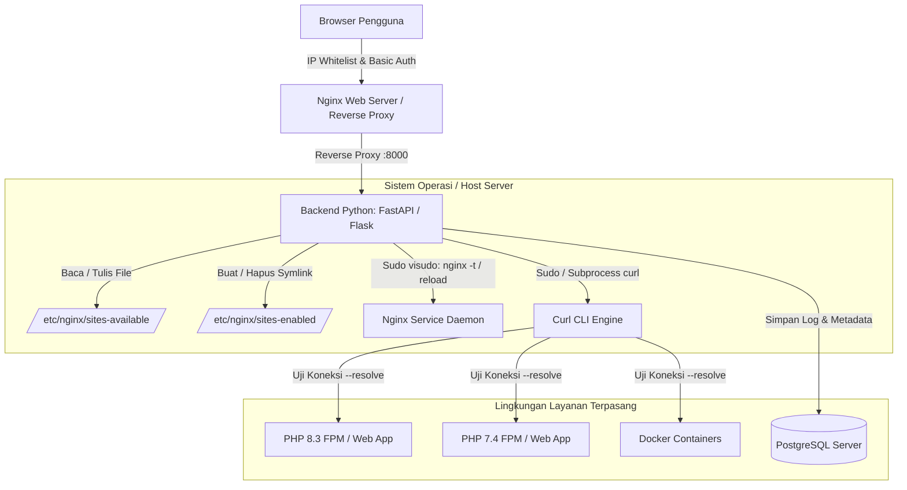
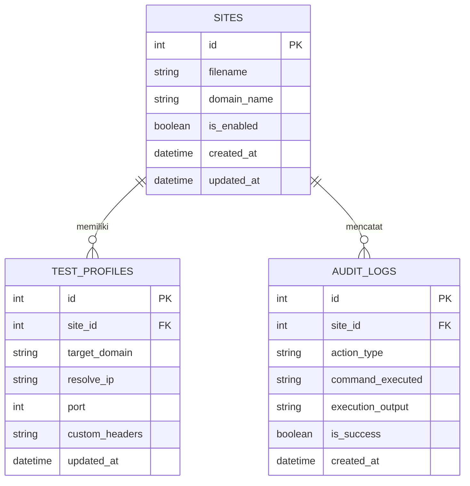

# PRD — Dashboard Server

## Overview
Dashboard Server adalah aplikasi web *internal tool* minimum viable product (MVP) yang dirancang untuk mengelola konfigurasi server Nginx, baik pada *environment* lokal maupun VPS produksi. Pada fase awal (Tahap 1), dashboard berfokus pada manajemen berkas konfigurasi *virtual host* (`sites-available` dan `sites-enabled`), validasi sintaks Nginx (`nginx -t`), reload Nginx otomatis dan aman, serta verifikasi konektivitas situs menggunakan utilitas `curl` dengan dukungan *custom host/IP mapping* (`--resolve`).

## Requirements
### Kebutuhan Fungsional
1. **Manajemen Berkas Konfigurasi Nginx**:
   - Membaca, membuat, mengedit, dan menghapus berkas konfigurasi di direktori `/etc/nginx/sites-available/`.
   - Mengaktifkan dan menonaktifkan konfigurasi dengan membuat atau menghapus *symbolic link* (symlink) ke `/etc/nginx/sites-enabled/`.
2. **Editor Berkas Konfigurasi**:
   - Tampilan antarmuka *raw text editor* terintegrasi berbasis Monaco atau Ace Editor dengan penyorotan sintaks (*syntax highlighting*) Nginx.
3. **Validasi dan Reload Nginx**:
   - Eksekusi perintah `nginx -t` secara langsung via *sudoer* tanpa meminta password interaktif.
   - Opsi *reload* konfigurasi Nginx (`systemctl reload nginx`) yang hanya dapat dieksekusi jika `nginx -t` menghasilkan status valid (sukses).
4. **Verifikasi Ketersediaan Situs (Curl Tester)**:
   - Pengujian ketersediaan HTTP/HTTPS terhadap domain yang dikelola.
   - Kemampuan pengujian domain lokal/baru tanpa DNS publik dengan injeksi parameter `--resolve` atau kustomisasi header `Host`.
   - Menampilkan status kode HTTP, respon header, dan waktu latensi.
5. **Keamanan Akses**:
   - Proteksi akses antarmuka dashboard menggunakan kombinasi HTTP Basic Authentication dan pembatasan IP (IP Whitelist).

### Kebutuhan Non-Fungsional
1. **Kompatibilitas Lingkungan**: Dapat berjalan konsisten di lingkungan lokal (berdampingan dengan PHP 8.3, PHP 7.4, PostgreSQL, Docker) dan lingkungan VPS Linux.
2. **Keandalan dan Keamanan Eksekusi**: Izin eksekusi perintah sistem dibatasi secara ketat pada aturan `visudo` khusus perintah Nginx dan Curl.
3. **Performa**: Eksekusi pengujian konfigurasi dan pengujian jaringan memberikan umpan balik *real-time* kepada pengguna.

## Core Features
1. **Nginx Site Manager**:
   - Daftar status virtual host (Aktif/Nonaktif).
   - *Toggle Switch* untuk pembuatan/penghapusan symlink.
   - *Raw Code Editor* untuk memodifikasi konfigurasi secara langsung.
2. **Nginx Diagnostic Runner**:
   - Tombol "Test Nginx Config" untuk menjalankan `sudo nginx -t`.
   - Konsol log interaktif untuk menampilkan pesan `stdout` dan `stderr`.
   - Tombol "Reload Nginx" yang terkunci otomatis jika validasi sintaks gagal.
3. **Curl Connectivity Tester**:
   - Form pengujian domain dengan opsi: URL target, Target IP (resolusi manual), Port, dan Protokol (HTTP/HTTPS).
   - Penampil keluaran diagnostik curl (HTTP Status Code, TTFB, SSL Status).
4. **Audit & Log Riwayat**:
   - Pencatatan aktivitas pengeditan berkas, hasil pengujian sintaks, dan hasil eksekusi curl ke dalam basis data.

## User Flow
1. **Akses Dashboard**: Pengguna mengakses URL dashboard, melewati filter IP Whitelist, dan memasukkan kredensial HTTP Basic Auth.
2. **Navigasi Situs**: Pengguna melihat daftar file konfigurasi pada `sites-available` beserta status symlink di `sites-enabled`.
3. **Penyuntingan Konfigurasi**:
   - Pengguna memilih berkas atau membuat berkas baru.
   - Pengguna menyunting teks konfigurasi melalui Monaco/Ace Editor.
   - Pengguna menyimpan perubahan berkas ke disk server.
4. **Validasi Sintaks**:
   - Pengguna menekan tombol "Test Syntax".
   - Sistem menjalankan `sudo nginx -t` dan menampilkan respons.
5. **Aktivasi & Reload**:
   - Jika sintaks valid, pengguna mengaktifkan toggle symlink (`sites-enabled`).
   - Pengguna menekan tombol "Reload Nginx".
6. **Verifikasi Ketercapaian (Curl Test)**:
   - Pengguna memilih tab/fitur "Curl Test".
   - Pengguna menentukan host dan IP tujuan (misal: domain lokal diarahkan ke `127.0.0.1`).
   - Sistem menjalankan perintah curl dan menampilkan status kode (misal: `HTTP 200 OK`).

## Architecture


## Database Schema


### Penjelasan Tabel
1. **sites**: Menyimpan referensi nama berkas konfigurasi Nginx di `sites-available`, domain utama yang dideteksi, serta status symlink di `sites-enabled`.
2. **test_profiles**: Menyimpan konfigurasi parameter `curl` (seperti target IP resolusi lokal, port, dan custom header) agar pengujian ulang dapat dilakukan secara instan.
3. **audit_logs**: Menyimpan riwayat perubahan konfigurasi, eksekusi perintah `nginx -t`, reload Nginx, dan hasil pengujian konektivitas curl.

## Tech Stack
| Komponen | Teknologi |
| :--- | :--- |
| **Backend Framework** | Python (FastAPI atau Flask) |
| **Frontend UI & Editor** | HTML5, Tailwind CSS, Monaco Editor / Ace Editor |
| **Web Server / Reverse Proxy**| Nginx (sebagai web server utama, Basic Auth, dan IP Whitelist) |
| **Database** | PostgreSQL |
| **System Integrations** | Linux Sudoers (`visudo`), Systemd (`systemctl`), CLI `curl` |
| **Runtimes Terkait** | PHP 8.3-FPM, PHP 7.4-FPM, Docker Engine |

## Seed Data
```sql
-- Inisialisasi Data Situs Contoh
INSERT INTO sites (filename, domain_name, is_enabled, created_at, updated_at)
VALUES 
('default', 'localhost', true, NOW(), NOW()),
('app-php83.local', 'app-php83.local', true, NOW(), NOW()),
('legacy-php74.local', 'legacy-php74.local', false, NOW(), NOW());

-- Inisialisasi Profil Pengujian Curl
INSERT INTO test_profiles (site_id, target_domain, resolve_ip, port, custom_headers, updated_at)
VALUES 
(2, 'app-php83.local', '127.0.0.1', 80, '{"Host": "app-php83.local"}', NOW()),
(3, 'legacy-php74.local', '127.0.0.1', 80, '{"Host": "legacy-php74.local"}', NOW());

-- Contoh Log Awal
INSERT INTO audit_logs (site_id, action_type, command_executed, execution_output, is_success, created_at)
VALUES 
(2, 'NGINX_TEST', 'nginx -t', 'nginx: the configuration file /etc/nginx/nginx.conf syntax is ok\nnginx: configuration file /etc/nginx/nginx.conf test is successful', true, NOW());
```

## Task Breakdown
### Sprint 1: Setup Proyek, Keamanan, & Skema Basis Data
- [ ] Inisialisasi proyek Python (FastAPI/Flask) dan struktur modular.
- [ ] Konfigurasi skema database PostgreSQL menggunakan migrasi.
- [ ] Siapkan konfigurasi reverse proxy Nginx untuk akses dashboard (Basic Auth & IP Whitelist).
- [ ] Konfigurasi aturan izin sistem `visudo` untuk user aplikasi dashboard (`nginx -t`, `systemctl reload nginx`).

### Sprint 2: Nginx Config File & Symlink Management
- [ ] Buat modul I/O berkas untuk membaca dan menulis di direktori `/etc/nginx/sites-available/`.
- [ ] Implementasikan integrasi antarmuka raw text editor (Monaco/Ace Editor).
- [ ] Buat modul pembuatan dan penghapusan *symbolic link* di `/etc/nginx/sites-enabled/`.
- [ ] Implementasikan API dan UI untuk manajemen list situs (tambah, baca, ubah, hapus).

### Sprint 3: Validasi Sintaks, Reload, & Modul Curl Tester
- [ ] Bangun endpoint backend untuk memanggil perintah `sudo nginx -t` secara aman menggunakan `subprocess`.
- [ ] Tampilkan hasil validasi sintaks pada terminal log UI.
- [ ] Bangun logika eksekusi *safe reload* (`sudo systemctl reload nginx`) yang divalidasi oleh hasil tes sintaks.
- [ ] Implementasikan runner pengujian ketersediaan menggunakan CLI `curl` dengan flag `--resolve` atau kustomisasi header `Host`.
- [ ] Tampilkan ringkasan status kode HTTP dan header respon pada antarmuka.

### Sprint 4: Pengujian Terpadu & Validasi Lintas Lingkungan
- [ ] Uji coba skenario modifikasi vhost untuk PHP 8.3, PHP 7.4, dan Docker reverse proxy pada lingkungan lokal.
- [ ] Simulasikan penanganan error ketika sintaks Nginx mengalami galat (*invalid syntax*).
- [ ] Deploy dan uji coba kesesuaian sistem pada VPS produksi.
- [ ] Dokumentasi penggunaan operasional dan prosedur pemeliharaan izin sudo.

## Asumsi
1. Sistem operasi target pada komputer lokal dan VPS adalah keluarga Linux berbasis Debian/Ubuntu yang memiliki struktur direktori standar `/etc/nginx/sites-available` dan `/etc/nginx/sites-enabled`.
2. Akun *system user* yang menjalankan aplikasi Python dashboard memiliki hak akses tulis (*write access*) pada direktori Nginx terkait atau diberikan izin khusus via grup sistem.
3. Kredensial koneksi ke server PostgreSQL lokal telah tersedia dan dapat diakses melalui environment variable.
4. Utilisasi `curl` mendukung flag modern `--resolve` (curl versi 7.21.3 ke atas).
5. Konfigurasi HTTP Basic Auth dan IP Whitelist dihandle langsung pada blok Nginx server yang membungkus antarmuka aplikasi dashboard, bukan pada layer aplikasi Python.